# 战斗生命周期钩子点地图

> 共创框架配图：沿战斗生命周期枚举"机制生效点"，对照 CombatEvent 事件流与代码结算点现状。
> 三档状态：**已有** = 结算点/事件现成（绿）｜**半** = 雏形或预留（黄）｜**缺** = 缺失，是触发类新机制的前提（红）。
> 浏览器查看版：`battle_hook_points.html`（双击打开）
> 依据：`../planning/mechanics_synergy_framework.md`（2026-11-15）；battle §二/§5.2/§六/§七；代码锚点见该文 §二表格。

```mermaid
flowchart TD
    subgraph OPEN["开战 startBattle（BattleSystem.java:63-124）"]
        direction LR
        O1["已有 · 装备被动落地<br/>常驻状态（龙心 REGEN）"]
        O2["半 · 开局效果通道<br/>仅支持 SHIELD，其余直接抛错"]
        O3["缺 · 战斗开始信号<br/>无事件、无通用挂点"]
    end

    subgraph PH1["① 状态推进（每 tick）"]
        direction LR
        S1["已有 · DOT/REGEN 周期心跳<br/>1s 心跳，装备被动可自定义间隔"]
        S2["缺 · 状态到期/移除信号"]
    end

    subgraph PH2["② 弹道推进"]
        direction LR
        P1["缺 · 命中前窗口<br/>减伤修改/反弹弹道的插入位"]
        P2["已有 · 落空<br/>PROJECTILE_FIZZLED"]
    end

    subgraph PH3["③ 行动链（每单位，id 序）"]
        direction LR
        A1["缺 · 出手前<br/>决策已定、roll 暴击前"]
        A2["已有 · 出手/发射<br/>ATTACK_LAUNCHED"]
        A3["缺 · 施法前<br/>能量检查之后"]
        A4["已有 · 技能施放<br/>CAST（注意：在效果应用前发出）"]
        A5["缺 · 施法后<br/>效果全部完成时"]
        A6["缺 · 移动前后<br/>口径 #20 移动不产事件"]
    end

    subgraph DMG["伤害管线（横切：弹道命中 / 近战 / 技能直伤共用）"]
        direction LR
        D1["缺 · 受击前窗口<br/>免伤% / 格挡的修改点"]
        D2["已有 · 命中落地<br/>HIT（伤害已扣完、双方已回能）"]
        D3["半 · 受击后<br/>回能+5 与普攻吸血 = 硬编码雏形"]
        D4["缺 · 反弹 / 受击触发"]
    end

    subgraph PH4["④ 死亡清扫（H 语义）"]
        direction LR
        C1["已有 · 死亡<br/>UNIT_DIED（不带击杀者归因）"]
        C2["缺 · 击杀后触发"]
        C3["半 · 亡语插入位<br/>battle §九 预留，现无实现"]
    end

    subgraph PH5["⑤ 胜负 / 超时"]
        E1["已有 · 战斗结束<br/>BATTLE_ENDED"]
    end

    GAP["六大关键缺口（触发类机制的共同前提）<br/>击杀归因 · 受击窗口 · 出手前/施法前窗口<br/>死亡触发 · 开局效果只认 SHIELD · 状态到期信号"]

    OPEN --> PH1 --> PH2 --> PH3 --> DMG --> PH4 --> PH5
    PH5 --> GAP

    classDef has fill:#1e3a2a,stroke:#27ae60,color:#bfe8d0
    classDef half fill:#3a3221,stroke:#f1c40f,color:#f5e6b8
    classDef miss fill:#3a2226,stroke:#c0392b,color:#e8a9a9
    classDef gap fill:#2b2b3a,stroke:#a569bd,color:#dcc8ee
    class O1,S1,P2,A2,A4,D2,C1,E1 has
    class O2,D3,C3 half
    class O3,S2,P1,A1,A3,A5,A6,D1,D4,C2 miss
    class GAP gap
```

## 概念澄清（读图前提）

- **CombatEvent 事件流**（battle §二）＝事后事实记录：逻辑层只写不读，消费者是渲染 / 回放 / 测试——它**不是**钩子系统。
- **钩子（"监听"）**＝逻辑结算管线里的生效插入点：现状全部硬编码（吸血、回能两处），没有可配置挂载。
- 两种落地形态（讨论点 D3）：**管线内挂点**（结算函数留触发位）或**逻辑内事件分发**（逻辑层消费自己的事件副本）。
