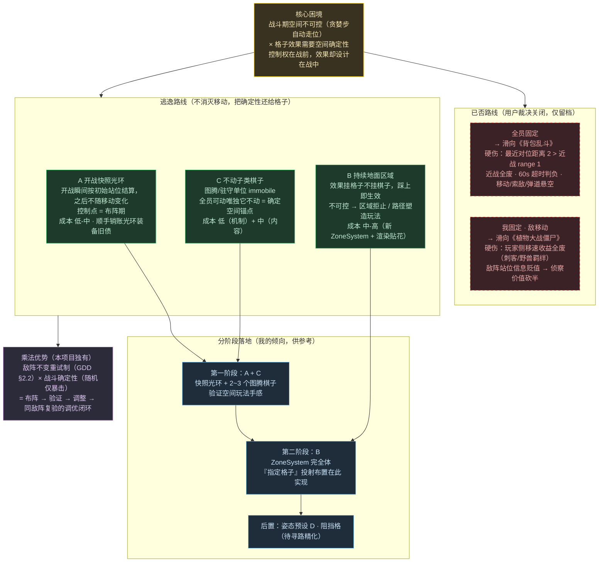

# 格子棋子设计空间：逃逸路线图

> 困境（战斗期空间不可控 × 格子效果需要空间确定性）→ 两条已否路线（留档）→ 三条逃逸路线（A/C/B）→ 分阶段落地。
> 浏览器查看版：`battle_zone_escape_routes.html`（双击打开）
> 依据：`../planning/battle_zone_pieces.md`（策划分析讨论稿，2026-09-23）；锚点见该文引用（GDD §2.1/§2.2/§4.1/§5.1/§6.3/§6.4/§10.2；battle §三/四/§5.3/§八；architecture §2.1/§六；`MovementSystem.java:24-51`）

## 路线对照表

| 路线 | 控制点 | 关键咬合 | 主要风险 | 量级 |
|---|---|---|---|---|
| A 快照光环 | 布阵期（邻接关系） | 双实体开战快照（architecture §2.1）；旧债销账（phase5 §8 差异声明 #3） | 战斗中光环不随移动，需表现层光柱提示 | 低-中 |
| C 不动棋子 | 布阵期（放置位置） | 决策链跳过分支；仍可被索敌攻击 | 纯近战不动棋永够不着——加载校验禁止 | 低+中 |
| B 地面区域 | 布阵期 + 路径预判 | 毒雾弹雏形（data_schema §5.5）；StatusSystem 词表全复用 | 贪婪步遇阻罚站 → 拖战斗撞 60s 超时；阻挡格依赖寻路精化 | 中-高 |
