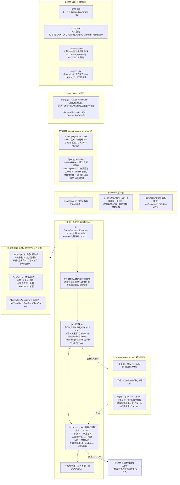

# 棋子与羁绊 v5 落地——机制接线架构图

> 实施计划配图：`../spec_plan/2026-11-21_units_synergies_v5.md` §5。
> 浏览器查看版：`units_synergies_v5_arch.html`（双击打开）
> 规格源：`../planning/units_synergies_design_v5.md`（v5 终稿，2026-11-21）

## 关键口径速记

| 口径 | 出处 | 落点 CP |
|---|---|---|
| C2 两遍式级联 | v5 §3.3 | CP14 |
| C5 双响/凶手转移/绝响重选 | v5 §3.3 | CP15/CP18 |
| C7 倒地五项+四过滤点+时钟冻结 | v5 §3.3 | CP17 |
| C8 最近继承=可行动存活 | v5 §3.3 | CP16 |
| C10/C13 放逐=非死亡事件 | v5 §3.3 | CP8/CP16 |
| 计数通道不走 StatusType/开战快照 | v5 §4.1 | CP12 |
| 只拦普攻弹道（skill==null） | v5 §4.1 | CP24 |
| 必暴仍消耗 RNG 序、覆写结果 | v5 §一.8 | CP27 |
| D10 敌方档位截断 | v5 §4.1 | CP7 |
