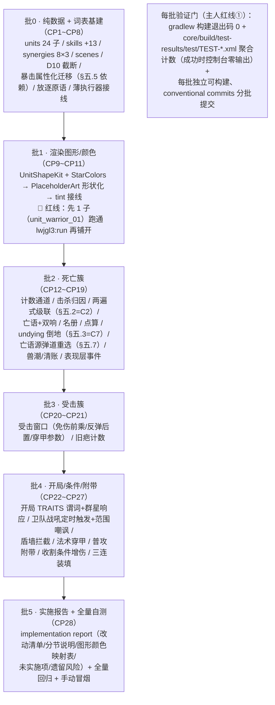

# 棋子与羁绊 v5 落地——批次切分与验证门图

> 实施计划配图：`../spec_plan/2026-11-21_units_synergies_v5.md` §7。
> 浏览器查看版：`units_synergies_v5_batches.html`（双击打开）
> 切分依据：v5 D11（三批钩子：死亡簇→受击簇→开局/条件/附带）+ 主人追加（批0 纯数据先行 / 批1 渲染小步 / 批5 报告收尾）。

## 各批 CP 归属

| 批 | CP | 内容一句话 | 批内关键验证点 |
|---|---|---|---|
| 批0 | CP1 | StatKey 暴击属性化（CRIT_CHANCE/CRIT_DAMAGE） | 既有战斗回归：默认 20%/×1.5 行为逐位不变 |
| 批0 | CP2 | 词表与数据类扩展（BURN/GAIN_ENERGY/KNOCKBACK/BANISH/SynergyMechanic/DeathrattleSpec/UndyingSpec/CastCondition） | 纯数据类单测 |
| 批0 | CP3 | JsonLoader 三通道解析与校验 | 校验失败用例（未知键/缺参/互斥） |
| 批0 | CP4 | synergies.json 8 条全量重写 | JsonLoader 全量加载零警告级错误 + 档位快照测试 |
| 批0 | CP5 | units.json 24 子 + skills.json +13 | 费阶 10/9/5、传奇 cost=3、矩阵行列各 6 快照测试 |
| 批0 | CP6 | scenes.json shopUnlocks/enemyPool 重排 | 三场景加载校验 + 传奇不入商店池断言 |
| 批0 | CP7 | D10 敌方档位截断（resolve 计数上限） | r1/r6/r13/r20 四档截断单测 |
| 批0 | CP8 | 放逐原语 + BANISH/GAIN_ENERGY/KNOCKBACK 执行 + BURN 心跳 | 依账除名条件施放、放逐零死亡事件断言 |
| 批1 | CP9 | UnitShapeKit + StarColors（纯 JVM） | 24 子映射表全覆盖断言 |
| 批1 | CP10 | PlaceholderArt 形状绘制（小步 1 子→铺开） | 🔴 lwjgl3:run 人工冒烟两次（1 子 / 24 子） |
| 批1 | CP11 | 星级 tint 接线（UnitView/BattleRenderer/ShopBar） | 冒烟：敌我可辨、同族异职可辨、星级色可辨 |
| 批2 | CP12 | CombatCounters 计数通道（遗物/旧疤/普攻计数） | 有效值读取点加算/乘算分列单测 |
| 批2 | CP13 | 击杀归因 lastDamagerId + UNIT_DIED killer | 普攻/DOT/亡语三类致死归因断言 |
| 批2 | CP14 | DeathSystem 两遍式级联清扫（C2/C9） | 同 tick 互灭、级联死亡、快照先于清状态断言 |
| 批2 | CP15 | 亡语执行器（4 kind + 双响 C5） | 五亡语逐一 + 双响两发同 tick 断言 |
| 批2 | CP16 | 阵亡名册 + 大公点算（C8/C11） | 继承者资格/等距 id 小/<25% 线/无目标不触发 |
| 批2 | CP17 | undying 倒地全链（C7 五项+四过滤点+时钟冻结） | 倒地不可索敌/不可伤/DOT 冻结/1.0s 复活回满能 |
| 批2 | CP18 | 亡语源弹道（deathrattleBorn 真伤路由 + 消散重选） | §五.7：普攻弹维持 fizzle、亡语弹重选 |
| 批2 | CP19 | 兽潮 + 连环清账 + 渲染新事件消费 | 敌死触发兽潮、刺客击杀回满能、放逐不触发 |
| 批3 | CP20 | DamagePipeline 受击窗口（免伤/反弹/穿甲参数/事件序） | 免伤只作用直伤、反弹真伤回攻击者可致死 |
| 批3 | CP21 | 旧疤（SCAR：3 刀 1 层、6 层封顶、只认普攻） | DOT/反弹不喂层断言 |
| 批4 | CP22 | 开局 TRAITS 谓词 + OPENING_ENERGY + AFTER_CAST_ENERGY | 群星响应：开局 +50、施法后 +20 |
| 批4 | CP23 | TimedTriggerSystem + 卫队战吼范围嘲讽 | 6s 触发、3s 豁免重评估、目标死立即失效 |
| 批4 | CP24 | 盾墙拦截（只拦普攻弹道） | 技能弹/近战不受限、附带落空 |
| 批4 | CP25 | 普攻附带状态挂点（BURN/SLOW） | 近战/弹道两路、盾墙拦截后附带落空 |
| 批4 | CP26 | 收割条件增伤（EXECUTE <35% +40%） | 阈值上下伤害断言、与穿甲叠加序 |
| 批4 | CP27 | 三连装填（计数 + 必暴覆写 + ×2.0） | RNG 消耗序不变（对拍）、第 3 刀必暴 |
| 批5 | CP28 | 实施报告 + 全量回归 + 冒烟清单 | 报告结构完整性 + 全部测试绿 |
